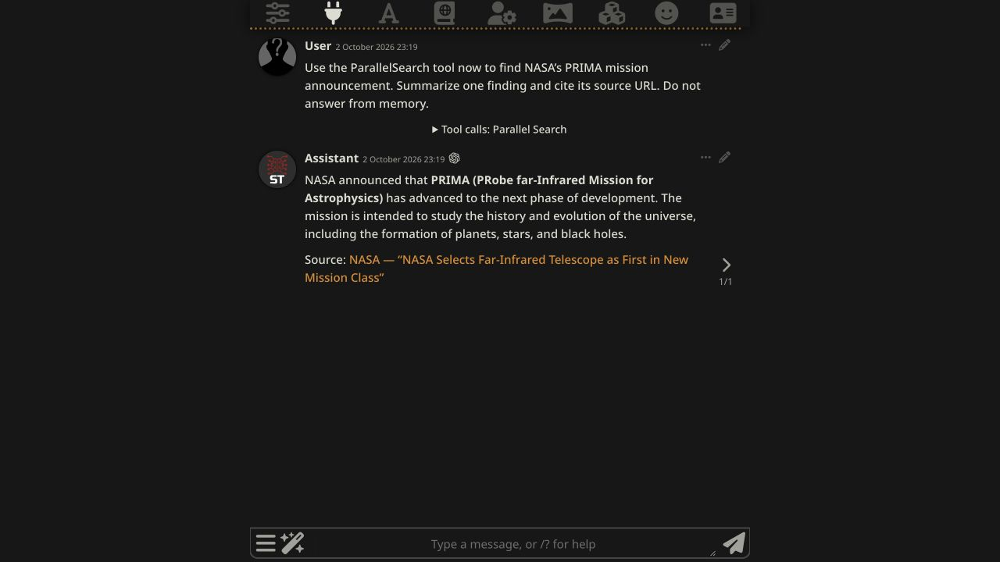

# Validation — v0.1.0

## Automated checks

`npm test`: 22 passing tests. Covers input validation, fixed upstream destination and Fast request, missing keys, upstream error redaction, timeout handling, malformed responses, URL filtering, deduplication, output budgets, separate user credentials, key replacement/removal and file permissions.

`npm run check`: syntax checks for the UI and server modules.

## Observed live results — 2 October 2026

- Clean upstream SillyTavern **1.19.0**, release commit `06bde939fb1e9c4c8d8641d810f0a916b5bce127`. No tracked core files modified; neither rejected PR applied; official Web Search extension absent.
- macOS, Node.js 22, Chromium-based Codex browser; isolated test data directory. Existing local SillyTavern dependencies were reused for this smoke test.
- Both the settings Search button and `/parallel-search` returned live Parallel titles, URLs and excerpts. The slash command displayed a notification without `/echo`.
- OpenAI `gpt-5.6-luna`, Chat Completion, function calling enabled, Reasoning Effort Minimum (`none`).
- Model-generated tool: `ParallelSearch`; query: `site:nasa.gov PRIMA mission announcement NASA`.
- Tool call ID: `call_BJOWQo8x8Qn2XYgfaeH3nCFX`; recorded `error: false`.
- Six result links and bounded excerpt text were returned to the model in a tool message. The model finished with a NASA source URL from those results.
- A 300-character budget produced exactly 300 characters in the UI. Disabling the plugin blocked a search with a clear message; re-enabling restored it. Reload preserved the saved key status.
- No provider responses were mocked in these browser checks; no direct function invocation substituted for the model-generated call.

## Manual release checks

Use an unmodified SillyTavern release with no official Web Search extension installed. Install both components following the README. Verify:

1. Settings show the server plugin and key status without displaying the stored key.
2. A direct Search button query returns titles, URLs and excerpts from the live API.
3. `/parallel-search NASA mission news` shows a visible notification without requiring `/echo`.
4. With function calling enabled, a normal prompt produces a recorded `ParallelSearch` call, returns results to the model, and yields an answer citing a returned URL.
5. Disabling the extension setting blocks slash searches and unregisters its tool. Re-enabling restores it.
6. Reload preserves the key status and settings. Budget 300 limits text to 300 characters.

These are integration smoke tests, not relevance, freshness or factual-accuracy benchmarks. Mocked error tests do not establish real-provider quota or failure behavior. Older SillyTavern versions, Windows, hosted installations, and every model/provider combination are not certified by these checks.
